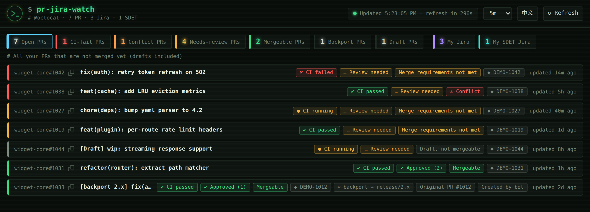

# pr-jira-watch

```
$ gh pr list --mine --open && acli jira search --mine --in-progress
> one screen. zero dependencies. no browser extensions. no SaaS.▌
```

A tiny watchtower for **your own open GitHub PRs** and **your Jira tickets**.
Pure Python 3 stdlib. It shells out to `gh`, `acli` and `twg`, so it reuses the auth you already have.

| Face | File | What it is |
|---|---|---|
| Web | `prwatch_web.py` | Dark CRT-style dashboard on `127.0.0.1:8765`, bilingual (EN / 中文) |
| TUI | `prwatch_tui.py` | `curses` UI. Also owns desktop notifications |
| CLI | `prwatch.py` | Plain table, `--once` for scripts. Shared core for the other two |

## Screenshot

> Rendered from **mock data** (`acme/widget-core`, `DEMO-*`, `@octocat`). No real repos, tickets or people.



Cards are filters. The left bar colour is urgency. The `EN` / `中文` button switches the language and is remembered.

## Contents

[Quick start](#quick-start) · [Requirements](#requirements) · [What gets watched](#what-gets-watched) · [Web UI](#web-ui) ·
[Mergeable rule](#the-mergeable-rule) · [TUI](#tui) · [CLI](#cli) · [Server](#web-server) · [Layout](#layout) · [Troubleshooting](#troubleshooting) · [Known gaps](#known-gaps)

## Quick start

```bash
./start.sh                    # two tmux sessions: prwatch (TUI + notifier) and prwatch-web (web)
xdg-open http://127.0.0.1:8765
```

`start.sh` is idempotent: sessions that already exist are skipped. The Jira site is read from `acli jira auth status`; set `JIRA_URL` to override it:

```bash
JIRA_URL=https://<your-site>.atlassian.net ./start.sh
```

```bash
tmux attach -t prwatch        # TUI + notifier
tmux attach -t prwatch-web    # web server
tmux kill-session -t prwatch-web && ./start.sh   # restart after editing the code
```

## Requirements

| Tool | Used for | Setup |
|---|---|---|
| `python3` >= 3.8 | everything | stdlib only, no `pip install` |
| `gh` | PR search, CI / review / merge state (GraphQL) | `gh auth login` |
| `acli` | Jira search (assignee / SDET), site URL | `acli jira auth login` |
| `twg` | PRs linked to a Jira ticket (dev panel) | optional, ~5s per batch, cached 120s |
| `tmux` | `start.sh` only | |
| `notify-send` / `powershell.exe` | desktop toasts (Linux / WSL) | optional |

## What gets watched

**PRs** (GitHub search `is:pr is:open archived:false`):
- `author:@me`
- `assignee:@me` **and** looks like a backport (the bot authors those, then assigns the original author)

**Jira** (JQL via `acli`):
- `assignee = currentUser() AND statusCategory = "In Progress"`
- `SDET = currentUser() AND statusCategory != Done`

A PR's Jira key is guessed from, in order: branch name, title, PR body (`/browse/KEY`, then `Jira: KEY`, then bare `KEY-123`).

```
gh (GraphQL)  ──► PRs, CI, review, merge state ─┐
acli (JQL)    ──► my Jira, SDET Jira ───────────┼──► prwatch.py ──► web / TUI / CLI
twg           ──► PRs linked to each ticket ────┘     (shared core)
```

## Web UI

Hover a card for its definition. The grey `#` line under the cards repeats it.

| Card (EN) | Card (中文) | Matches |
|---|---|---|
| Open PRs | 未合并 PR | every open PR, drafts included |
| CI-fail PRs | CI 失败 PR | CI is `FAILURE` / `ERROR` |
| Conflict PRs | 有冲突 PR | merge conflict with base |
| Needs-review PRs | 等 Review 的 PR | review required, not a draft |
| Mergeable PRs | 可合并 PR | passes the [mergeable rule](#the-mergeable-rule) |
| Backport PRs | Backport PR | title or branch says backport |
| Draft PRs | 草稿 PR | draft |
| My Jira | 我负责的 Jira | assignee = me, In Progress |
| My SDET Jira | 我是 SDET 的 Jira | SDET = me, not Done |

**PR row**: `repo#number`, title, CI badge, review badge, merge badge, Jira link, backport info, age.
Left bar: green = mergeable, red = CI fail or conflict, yellow = needs attention. Most urgent first.

**Jira row**: key, type, title, status, priority, and a rollup of linked PRs (`2 PR ✔`, `1 PR ✖`, `1 PR merged`, `No linked PR`).

Also:
- **Language**: `EN` / `中文` button, default Chinese, kept in `localStorage`.
- **Interval**: 30s to 30m picker, default 5m, kept in `localStorage`.
- **Copy**: one-click copy of the PR / Jira link on every row.
- **Tab title** carries the alarm: `✖2 ⚠1 ✔3 · PR & JIRA Watch · 12 PR`.
- **Instant open**: the last snapshot is served from `~/.cache/prwatch/web_cache.json` (mode `0600`, it holds PR titles and Jira summaries), then refreshed in the background.
- **Self-reload**: an open page reloads itself when the server code changes (build hash).

## The mergeable rule

```
ready(pr) = !draft
          && mergeStateStatus == CLEAN            # no conflict, required checks pass, not behind base
          && reviewDecision != CHANGES_REQUESTED
          && (reviewDecision == APPROVED || approvals > 0)
```

GitHub's own `mergeable` field only means "no git conflict". It used to drive the green badge, so a failing draft looked mergeable.
Now green means `ready`, and anything else says what is blocking:

| State | Web (EN) | CLI / TUI cell |
|---|---|---|
| ready | `Mergeable` | `ready` |
| conflict | `⚠ Conflict` | `conflict` |
| changes requested | `✖ Changes requested (n)` (review badge) | `changes` |
| draft | `Draft, not mergeable` | `draft` |
| behind base | `Behind base, update needed` | `behind` |
| required checks or review missing | `Merge requirements not met` | `blocked` |
| a check failed | `Some checks failing` | `unstable` |
| pre-merge hooks pending | `Pre-merge checks pending` | `hooks` |
| clean, nobody approved | `No conflict, needs approval` | `no-approve` |
| GitHub has not computed it yet | `Merge state unknown` | `?` |

One implementation for CLI and TUI: `prwatch.is_ready()` / `prwatch.merge_cell()`. The web UI mirrors it in JS (`ready()` / `mg()`), so change both together.

## TUI

```bash
./prwatch_tui.py [-i 60] [--org my-org] [--jira-url https://<your-site>.atlassian.net] [--no-notify]
```

| Key | Action |
|---|---|
| `j` `k` / arrows, `g` `G`, `PgUp` `PgDn` | move, top / bottom, page |
| `h` `l` / `Tab` / `1`-`9` | switch tab (`8` = Jira, `9` = SDET) |
| `space` | toggle select |
| `a` / `x` | select all / clear |
| `c` / `m` | copy links / copy Markdown |
| `o` / `J` | open PR / open Jira |
| `r` | refresh now |
| `?` | help |
| `q` `Esc` | quit |

Desktop notifications fire on **transitions only** (the first poll just records a baseline):
CI turns red, PR approved, changes requested, new merge conflict, and Jira tickets entering, leaving or changing status.
WSL goes through a Windows toast, Linux through `notify-send`, anything else rings the terminal bell.

## CLI

```bash
./prwatch.py                   # refresh every 60s
./prwatch.py -i 30             # every 30s
./prwatch.py --once            # print once and exit
./prwatch.py --org my-org      # one org only
./prwatch.py --no-notify       # no desktop toasts
./prwatch.py --test-notify     # fire a test toast and exit
./prwatch.py --jira-url https://<your-site>.atlassian.net
```

`JIRA_URL` is the env var equivalent of `--jira-url`.

## Web server

```bash
./prwatch_web.py [-p 8765] [--org my-org] [--jira-url https://<your-site>.atlassian.net]
```

Binds to `127.0.0.1` only. A 15s server-side cache means ten open tabs cost one GitHub query.

| Route | Returns |
|---|---|
| `/` | the page |
| `/api/prs` | fresh data (PRs, Jira, SDET, linked PRs, errors) |
| `/api/prs?cached=1` | last snapshot, no fetch, no lock |
| `/logo.png` `/logo.svg` `/favicon.ico` | assets |

## Layout

```
.
├── start.sh            # tmux launcher
├── prwatch.py          # core: queries, Jira key guess, backport detection, mergeable rule, notify, CLI
├── prwatch_tui.py      # curses UI + notifier loop
├── prwatch_web.py      # http.server + single-file SPA (EN / 中文 strings live in its I18N table)
├── logo.png            # header logo, favicon source (drop a logo.local.png next to it to override, gitignored)
└── docs/               # README screenshot
```

## Troubleshooting

| Symptom | Check |
|---|---|
| Page says `Cannot reach server` / `无法连接服务` | `tmux ls`, then `./start.sh` |
| `Refresh failed` | `gh auth status` |
| `Jira refresh failed` | `acli jira auth status` |
| `linked-PR lookup failed` | `twg` missing or logged out. Jira rows still work, only the linked-PR rollup is empty |
| Port 8765 busy | `./prwatch_web.py -p 8766` |
| No desktop toasts | the TUI session sends them, check `tmux attach -t prwatch`. Try `./prwatch.py --test-notify` |
| Page looks stale after a code edit | restart `prwatch-web`. Open pages reload themselves on the next poll |

## Known gaps

- The TUI and the CLI are not bilingual: English column headers, Chinese help text and notification titles.
- A brand-new PR may show `Merge state unknown` for a few seconds while GitHub computes mergeability.
- The web `ready()` rule is duplicated in JS. It has to be edited together with `prwatch.is_ready()`.
